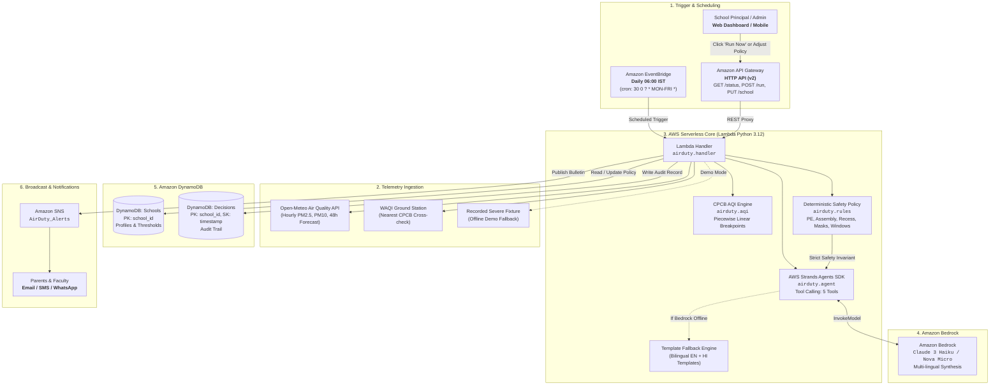

# Air Duty Officer for Schools: Architecture & Data Flow

> Automated Morning Air Quality Assessment, Policy Decision Engine & Multi-Channel Alert Dispatch.

---

## 🏛️ System Architecture Diagram

---

## 🔄 End-to-End Execution Flow

### Phase 1: Automated Morning Trigger (06:00 IST)
1. **EventBridge Rule**: At `00:30 UTC` (06:00 AM Indian Standard Time), Amazon EventBridge emits a scheduled event to the AWS Lambda function.
2. **On-Demand Runs**: Principals can also trigger immediate evaluations at any time from the Web Dashboard via `POST /run`.

### Phase 2: Telemetry Ingestion & CPCB AQI Calculation
1. **Open-Meteo API**: Fetches current hour concentration and 24-48h hourly forecasts for PM2.5 and PM10 for the school's lat/lon coordinates.
2. **Optional Ground Cross-Check**: If `WAQI_TOKEN` is configured, queries the nearest official DPCC/CPCB monitoring station.
3. **CPCB Breakpoints**: Computes sub-indices using the official Central Pollution Control Board (CPCB) linear interpolation formulas and identifies the dominant pollutant and overall AQI category (*Good, Satisfactory, Moderate, Poor, Very Poor, Severe*).

### Phase 3: Two-Layer Decision Engine
1. **Deterministic Rules Engine (`rules.py`)**:
   - Compares telemetry against school-specific policy thresholds.
   - Evaluates next 6-hour forecast peak to preempt sudden smog spikes.
   - Evaluates registered sensitive student count (e.g. 45 students with asthma).
   - Generates deterministic operational directives: Outdoor PE, Assembly, Recess, Masks, Classroom Ventilation.
   - Computes the **"Best Outdoor Window"** (the lowest PM2.5 2-hour period during school hours).
2. **AWS Strands Agents SDK + Amazon Bedrock (`agent.py`)**:
   - The agent orchestrates 5 tools (`get_air_quality`, `get_forecast`, `compute_cpcb_aqi`, `get_school_policy`, `draft_alert`).
   - Bedrock crafts polite, empathetic phrasing for principals and parents in English and Hindi.
   - **Safety Invariant**: The agent NEVER overrides or relaxes safety constraints defined by the rules engine.
   - **Deterministic Fallback**: If Bedrock is unreachable or credentials are unavailable, templated bilingual alerts are immediately emitted with zero downtime.

### Phase 4: Persistence & Dispatch
1. **Amazon DynamoDB**: Stores the complete decision object, telemetry snapshot, and delivery status in the immutable `Decisions` table.
2. **Amazon SNS**: Broadcasts the formatted directive bulletin to subscribed emails and phone numbers.
3. **Web Dashboard**: Displays today's decision card, reasons, 24-hour interactive forecast chart with the cleanest window highlighted, and last 7-day history.

---

## 🛡️ Security & Least-Privilege IAM

The AWS SAM template implements strict least-privilege IAM policies:
- **DynamoDB**: Lambda is granted `DynamoDBCrudPolicy` strictly scoped to `AirDuty_Schools` and `AirDuty_Decisions` tables.
- **Amazon SNS**: Granted `SNSPublishMessagePolicy` strictly scoped to `AirDuty_Alerts` topic.
- **Amazon Bedrock**: Granted scoped `bedrock:InvokeModel` and `bedrock:InvokeModelWithResponseStream` permissions.
- **No Hardcoded Secrets**: All configuration is managed via environment variables (`BEDROCK_MODEL_ID`, `AWS_REGION`, `WAQI_TOKEN`).
